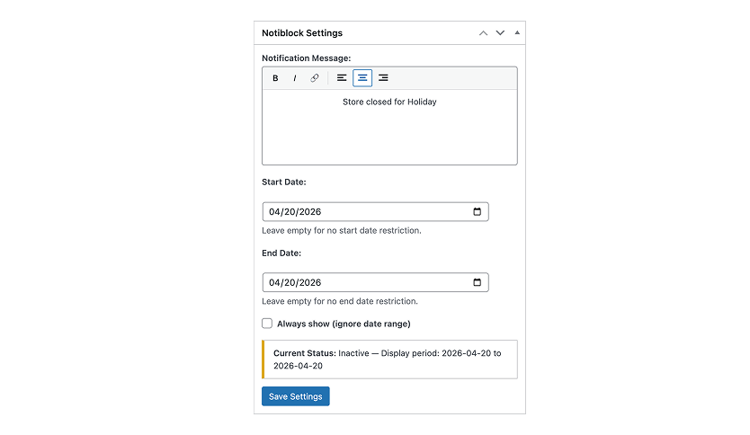

# Notiblock

Shows one site-wide notification message between a start and end date, placed with two blocks.



The plugin stores a single message, a start date, an end date and an "always show" flag. Two blocks in a "Notiblock" category put the message on the page:

- `notiblock/conditional` renders its inner blocks while the notification is active and nothing otherwise.
- `notiblock/message` prints the stored message, run through `wpautop()` and `wp_kses_post()`. It can only be placed inside a Conditional block.

Every copy of the blocks shows the same message and follows the same dates, so a site-wide banner can be dropped into a header template once and switched on and off from the dashboard.

## Requirements

- WordPress 6.7 or later
- PHP 7.4 or later
- Node.js 22 or later to build the blocks

## Installation

1. Download `notiblock.zip` from the [latest release](https://github.com/philhoyt/Notiblock/releases/latest).
2. In the WordPress admin, go to Plugins > Add New Plugin > Upload Plugin and choose the zip.
3. Activate the plugin.

Updates come from GitHub releases through Plugin Update Checker, which installs the zip attached to the release. The plugin is not on WordPress.org.

## Usage

Open the Notiblock Settings dashboard widget or Settings > Notiblock. Write the message (bold, italic, links and alignment are available), set the dates, and save. The widget shows whether the notification is currently active.

Then add a Notiblock Conditional block wherever the message should appear and put a Notiblock Message block inside it. Other blocks can go inside the Conditional block as well; they show and hide with the notification.

How the dates are read:

- Active when today is on or after the start date and on or before the end date, in the site's timezone.
- Either date can be empty, which removes that limit.
- With both empty, nothing is shown unless "Always show (ignore date range)" is ticked.
- "Always show" overrides the dates.
- The settings form rejects a start date in the past and an end date before the start date. Malformed dates are cleared on save.

## Configuration

Settings are one option, `notiblock_global_notice`, holding `content`, `start_date`, `end_date` and `always_show`.

On multisite each site has its own option by default. To share one notification across the network, set the constant or the filter:

```php
define( 'NOTIBLOCK_NETWORK_WIDE', true );
// or
add_filter( 'notiblock_use_network_settings', '__return_true' );
```

In network-wide mode the option is stored with `update_site_option()` and the settings page is at Network Admin > Settings > Notiblock, gated by `manage_network_options`.

## REST API

| Route | Method | Capability | Purpose |
|-------|--------|------------|---------|
| `/wp-json/notiblock/v1/settings` | GET | `edit_posts` | Read the settings; the block editor uses it to preview the message |
| `/wp-json/notiblock/v1/settings` | POST | `manage_options` (or `manage_network_options` in network-wide mode) | Save the settings; returns 400 when the end date is before the start date |

## Development

```bash
npm install
composer install
npm start           # watch src/ and rebuild into build/ (copies render.php, writes the blocks manifest)
npm run build       # production build
npm run lint:js
npm run lint:css
npm run format
composer run lint   # phpcs
composer run lint:fix
npm run plugin-zip  # build the distributable zip from the package.json files list
```

PHPUnit runs inside wp-env against `tests/` (date logic, settings saving and sanitising, REST permissions):

```bash
npm run env:start
npm run test:php
npm run i18n:pot    # regenerate languages/notiblock.pot inside wp-env
```

CI (`.github/workflows/ci.yml`) runs phpcs and `composer audit` on PHP 8.3, `php -l` on PHP 7.4 and 8.3, ESLint, Stylelint, the build and `npm audit --omit=dev`, then PHPUnit in wp-env.

## Releases

Bump the version in `notiblock.php`, `package.json` and both `block.json` files, set `Stable tag` and add the changelog entry in `readme.txt`, then push a lowercase `v` tag:

```bash
git tag v1.1.1 && git push origin v1.1.1
```

The release workflow builds the blocks, runs `npm run plugin-zip`, checks that the zip contains the plugin file, `uninstall.php`, `readme.txt`, `build/`, `languages/notiblock.pot` and Plugin Update Checker (and does not contain `node_modules/`, `src/`, `tests/`, `.github/` or `vendor/`), takes that version's section of the `readme.txt` changelog as the release notes, and attaches `notiblock.zip` and `readme.txt` to the GitHub release.

Tags must be lowercase `v`: Plugin Update Checker strips the prefix with a case-sensitive `ltrim`, so an uppercase tag is never offered as an update. The repository's old `V1.0.0` tag is one of those.

## Limitations

- One message per site (or per network in network-wide mode). There is no way to run two notifications with different dates.
- Dates are whole days in the site's timezone; there is no time of day.
- The message allows the HTML that `wp_kses_post()` allows. No images or embeds are offered in the editor.
- Deleting the plugin removes the option on every site; the blocks left in content render nothing once the plugin is gone.

## License

GPL-2.0-or-later
